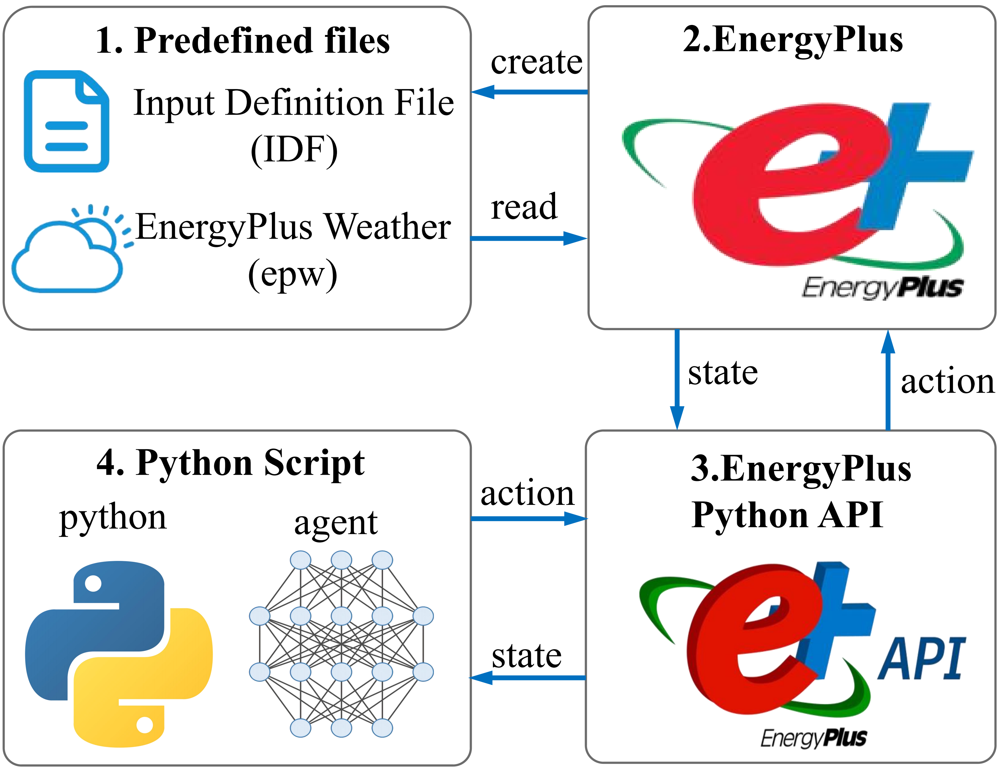

# DCMADRL

This repository contains the implementation of the algorithm proposed in the paper:

**Distributional Constrained Multi-Agent Deep Reinforcement Learning for Multi-Zone HVAC Control**

All codes for the DCMADRL algorithm and related experiments are included.

---

## Environment

| Component         | Version / Requirement |
|------------------|----------------------|
| Operating System | Windows 10 / 11      |
| EnergyPlus       | v23.2                |
| Python           | ≥ 3.11               |

---

## Notes

- The EnergyPlus–Python co-simulation framework is integrated into this repository.
- EnergyPlus (v23.2) is required to run the simulations.

### DCMADRL critic architecture

The `DCMADRL/` training entry point uses centralized critics with the joint
observations and actions of all five agents (65 input features):

- Reward: two distributional critics, each predicting 32 quantile values.
- Cost: one distributional critic predicting 32 quantile values, plus its
  soft-updated target network. A target network is not a second online cost critic.
- Cost training uses the distributional target `c + gamma * Z_cost_target` and
  pairwise quantile Huber regression, without a reward-entropy term.
- The actor uses the interval-weighted expectation of the cost quantiles in the
  existing constraint penalty. This is an expected-cost constraint, not CVaR.

The cost-distribution correction replaces the earlier scalar/MSE cost critic.
The default model scenario is now `simple_tag_distributional_cost_v1`, keeping
new saved parameters separate from the old `simple_tag` models. Old scalar cost
critic checkpoints cannot be loaded into this architecture; retrain the updated
algorithm before reporting its performance. The reward branch, cost limit,
constraint penalty, and the separate ablation folders are unchanged.

Regression checks (run from the repository root with PyTorch installed):

```text
python -m unittest discover -s DCMADRL/tests -v
```

The tests default to CPU. Set the environment variable `DCMADRL_TEST_DEVICE=cuda`
to check CUDA as well. They cover joint inputs, quantile loss and targets, actor
cost gradients, target updates, checkpoint compatibility, and a synthetic training
update for each of the five agents. These checks do not constitute a full
EnergyPlus training run or establish convergence or comparative performance.

---

## EnergyPlus–Python Co-Simulation Platform

<p align="center">
  
</p>

This figure illustrates the integrated EnergyPlus–Python co-simulation platform used in this work.
